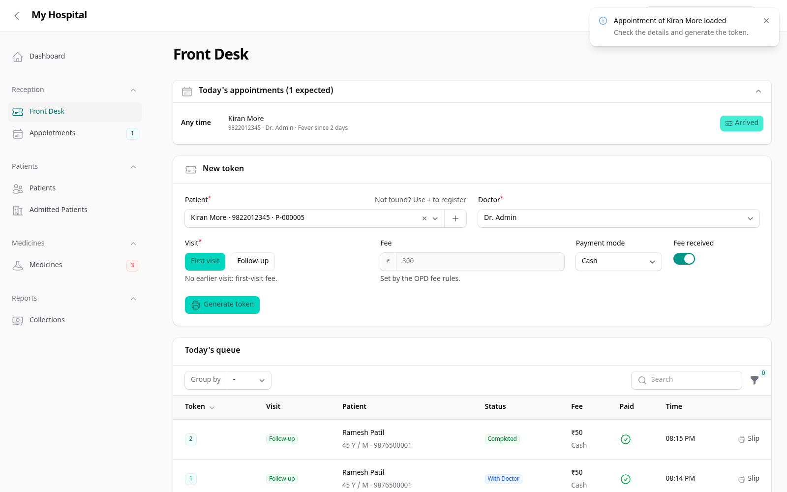
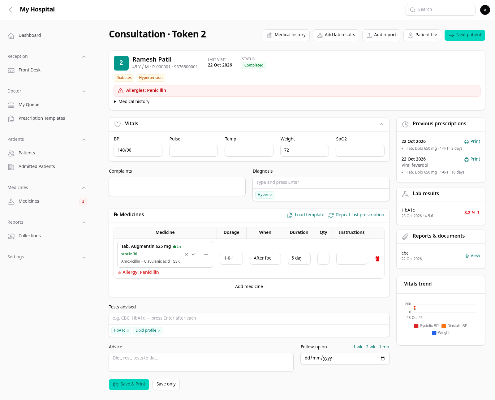
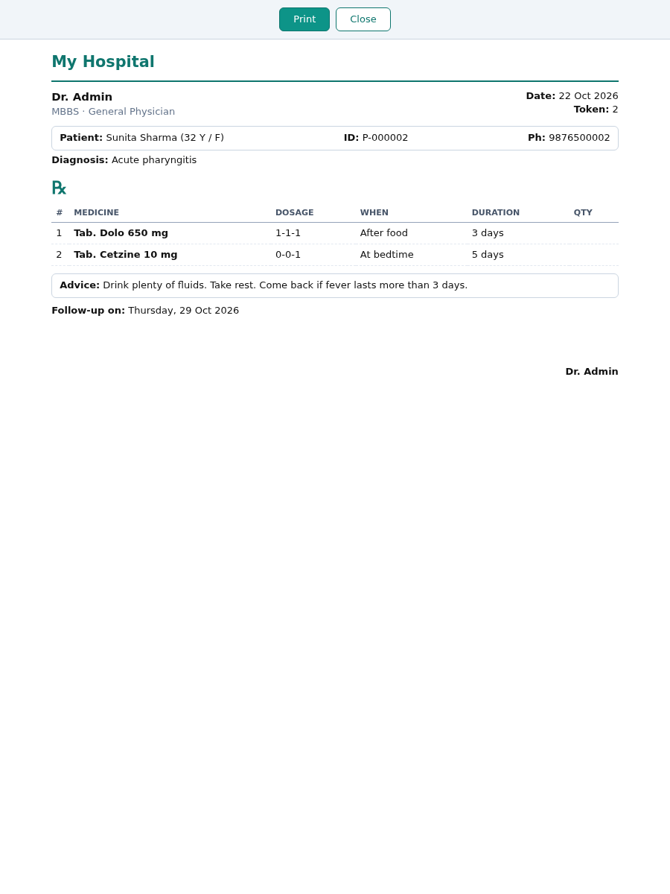
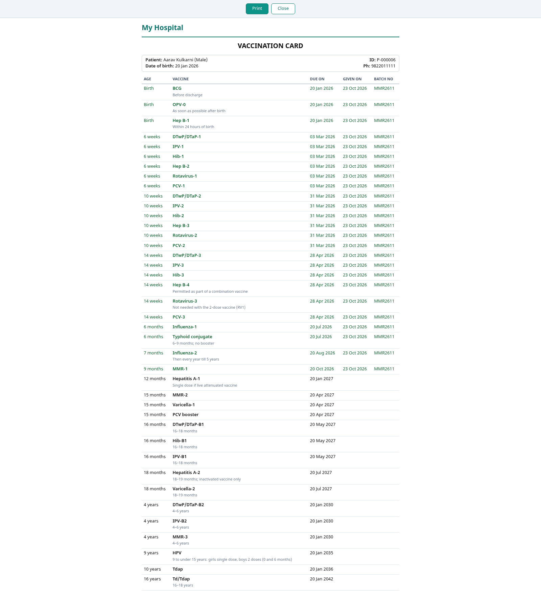
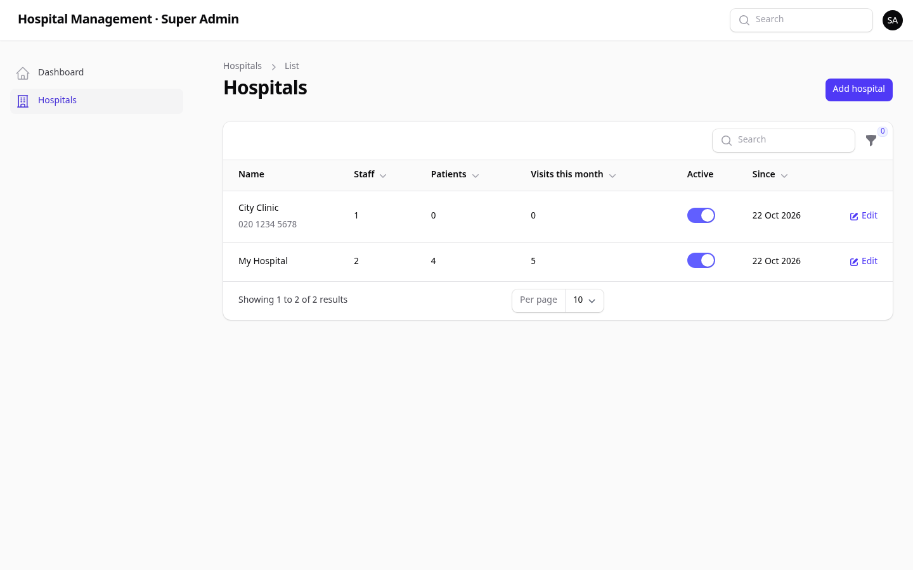

# Hospital Management

A hospital management system for hospitals and clinics in India, built with Laravel and Filament. One installation can run a single hospital on a local PC, or many independent hospitals on a cloud server, each with its own staff, patients and settings.

The source code is in a private repository. If you'd like to see it, write to me at sggawande143@gmail.com and I'll walk you through it or give you read access.

## Features

- **Reception:** OPD tokens, fees and receipts. The system works out first visit or follow-up from the patient's OPD card.
- **Doctors:** a live queue and a prescription pad with medicine search, templates and allergy warnings.
- **Patients:** records, medical history, lab results with trends, certificates and uploaded reports.
- **Admitted patients:** beds, vitals, medicines given, nursing notes and a discharge summary.
- **Medicines:** catalogue and stock, with low-stock alerts.
- **Optional modules:** child vaccinations and growth charts, antenatal care.
- **Waiting room:** a TV screen that shows the token being served.
- English and Marathi for printouts and the TV screen.

## Roles

Super admin, hospital admin, doctor, nurse and receptionist. Each role sees only its own part of the system. The super admin adds and manages hospitals but can't see any patient data.

## Tech

- PHP 8.3, Laravel 13, Filament 5, MySQL 8
- Two-factor login (authenticator app) for staff
- Scheduled database backups
- PHPUnit feature and unit tests
- Runs behind Nginx on a server, or on a single PC for one hospital

## Screenshots

**Front desk:** new token, fee and today's queue

**Consultation:** history, allergies, vitals, lab results and the prescription pad

**Printed prescription**

**Vaccination card** from the child care module

**Super admin:** several hospitals on one installation

---

© 2026 Swapnil Gawande. All rights reserved.
